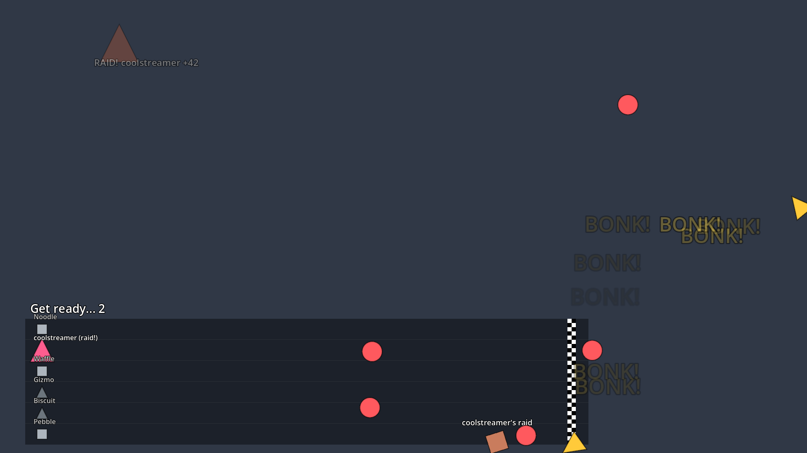

# lucidin-chaos (odditorium-widget)

A Twitch stream overlay built with **Godot 4.7.2** and driven by **Streamer.bot**. Viewers type chat commands to make silly things happen on screen. Channel point redeems are an optional extra.

**Everything is free for viewers.** No module may use bits, subs, gifts, donations or any other paid event. The core refuses to load such a module, and a test fails if one exists ([how it's enforced](#the-free-for-viewers-guarantee)).



| Module | Chat | What happens |
|---|---|---|
| **Critter Race** | `!join` (alias `!race`) | Join a race of little shapes. The race starts by itself once enough people join, or when the lobby timer runs out. NPC critters fill empty lanes, so it works with 1–3 chatters. A raid starts a race with the raider as a big critter. |
| **Bonk Physics** | `!bonk [@user] [object]` (alias `!yeet`) | Throws a physics object at your cam region. It bounces, lands and fades. Can also be a channel point redeem. A raid throws a barrage. |
| **Greeter** (example module) | `!hi` (aliases `!hello`, `!wave`) | Pops a shape with the viewer's name. Also thanks follows and raids. |

All placeholder art is plain squares, triangles and circles drawn in code, told apart by colour and size. Any of them can be [swapped for your own art](#swapping-in-your-own-art-and-sounds) through the config.

---

## Contents

- [Requirements](#requirements)
- [Setup](#setup)
- [Trying it without Streamer.bot (mock server)](#trying-it-without-streamerbot-mock-server)
- [Hooking it up: Streamer.bot + OBS (manual steps)](#hooking-it-up-streamerbot--obs-manual-steps)
- [Config reference](#config-reference)
- [Swapping in your own art and sounds](#swapping-in-your-own-art-and-sounds)
- [Adding a new module](#adding-a-new-module)
- [Tests](#tests)
- [How it works](#how-it-works)
- [Project layout](#project-layout)

---

## Requirements

- **Godot 4.7.2-stable**, the standard build (not .NET). Download it from <https://godotengine.org/download/archive/4.7.2-stable/>. On Windows, the `_console.exe` build shows log output, which helps when you're setting up.
- **Streamer.bot** 1.x, connected to your Twitch account.
- **OBS Studio**.
- For the test scripts: Godot. The integration script also needs bash and python3 (on Windows: Git Bash or WSL).

## Setup

1. Clone or download this repo.
2. Open Godot, choose **Import**, and pick `project.godot`. The first import takes a few seconds.
3. Edit **`lucidin_chaos.json`** in the project folder. See [Config reference](#config-reference). The defaults work as-is if Streamer.bot runs on the same PC on port 8080.
   - Tip: copy it to `lucidin_chaos.local.json` and edit that copy instead. It's git-ignored and takes priority over `lucidin_chaos.json`.
4. Press **F5** (Run Project) in the editor, or run `godot --path .` from the project folder.
   - If Streamer.bot isn't connected, a small status line appears in the top-left corner. It disappears once the overlay connects.
5. Optional: export a standalone build with **Project → Export** (Windows Desktop). Put `lucidin_chaos.json` and any `art/` folder next to the exported `.exe`.

**To close the overlay:** the window is borderless and lets clicks pass through, so close it from the taskbar (right-click → Close), with Alt+F4 after selecting it in the taskbar, or by stopping it in the Godot editor. If you'd rather click on it, set `"click_through": false`.

## Trying it without Streamer.bot (mock server)

The repo includes a mock Streamer.bot server, so you can watch the overlay react with nothing else installed:

```sh
# terminal 1: fake Streamer.bot playing demo traffic (on Windows, use the *_console.exe build)
godot --headless --path . --script res://tools/mock_streamerbot.gd -- --scenario=res://tools/scenarios/demo.json --loop

# terminal 2: the overlay
godot --path .
```

Mock options: `--port=8080`, `--password=secret` (turns on authentication), `--loop`, and `--exit-when-done`. The scenarios live in `tools/scenarios/`:
- `demo.json`: friendly traffic.
- `edge_cases.json`: spam, bad payloads, forced paid events and disconnects.
- `auth.json`: an authenticated server.

You can write your own using the step kinds listed in [`tools/mock/scenario_player.gd`](tools/mock/scenario_player.gd).

Overlay command-line options go after `--`: `--config=<path>`, `--port=<n>`, `--run-seconds=<s>`, `--screenshot=<s>:<file.png>` and `--screenshot-bg=<#color>`.

## Hooking it up: Streamer.bot + OBS (manual steps)

I couldn't run these steps from the cloud sandbox, so they're written for you to do by hand. The overlay subscribes to the Twitch events it needs straight from Streamer.bot's WebSocket server, so **you don't need to create any Streamer.bot actions, triggers or commands**.

### 1. Streamer.bot

1. Connect your Twitch **broadcaster** account under **Platforms → Twitch → Accounts**, with chat and EventSub connected. Channel point and raid events need the broadcaster account.
2. Open **Servers/Clients → WebSocket Server**:
   - Tick **Auto Start**, then click **Start Server**.
   - Address `127.0.0.1`, port `8080`, endpoint `/`. These match the config defaults. If you change them, update `streamerbot.host`, `streamerbot.port` and `streamerbot.endpoint` to match.
   - Optional: turn on **Authentication** and set a password. Put the same password in `streamerbot.password`.
3. Start the overlay. Streamer.bot's WebSocket server list should show a new client, and the overlay's status line disappears.
4. Test it: type `!hi` in your Twitch chat. A shape with your name should pop up.

### 2. Channel point redeems (optional, Affiliate+)

1. Create a custom reward on Twitch (Creator Dashboard → Viewer Rewards → Channel Points), or in Streamer.bot (**Platforms → Twitch → Channel Point Rewards**). Example title: **`Bonk the Streamer`**.
   - If you want the viewer to pick an object (`pillow`, `brick`…), turn on "Require viewer to enter text".
2. In `lucidin_chaos.json`, set `"redeems": {"enabled": true, ...}`. Map each reward's **exact title** (case-insensitive) to a command:
   ```json
   "rewards": { "Bonk the Streamer": { "command": "bonk", "args_from_input": true } }
   ```
3. Restart the overlay. It now also subscribes to `Twitch.RewardRedemption`.
   - Redeems skip per-user cooldowns by default, since the viewer spent points. They still go through the shared queue.

### 3. OBS

The overlay window is 1920×1080, borderless, with a transparent background. There are two ways to capture it:

- **Option A: Game Capture (recommended for transparency).** Add **Game Capture**, set Mode to "Capture specific window", pick `lucidin-chaos`, and tick **Allow Transparency**.
- **Option B: Window Capture.** Add **Window Capture** and pick the `lucidin-chaos` window. On some systems Window Capture shows a black background instead of transparency. If so, use a chroma key:
  1. In the config, set `"window": {"transparent": false, "background_color": "#00b140"}`.
  2. In OBS, right-click the source → **Filters** → add **Chroma Key** (key colour: green).

Then:
- Stretch the source to fill the canvas. The overlay's coordinates are in a 1920×1080 space.
- Line up `modules.bonk.target_region` with where your webcam sits. Set `"debug": {"show_regions": true}` to draw outlines of every region, adjust, then switch it off again.
- Keep the overlay window open but not minimised. A minimised window can't be captured.

> I couldn't verify transparency on Windows or OBS capture from the sandbox. Please check both on your machine; this item is also listed in `docs/DECISIONS.md`.

## Config reference

All settings are in **`lucidin_chaos.json`**. Every key is optional: anything you leave out uses the built-in default. Keys starting with `_` are comments.

Bad values never crash the overlay. Each one is logged as `[config] ...` and the default is used instead.

To print the complete default config, run `godot --headless --path . --script res://tools/dump_default_config.gd`.

The config file is chosen in this order:
1. `--config=<path>`
2. `lucidin_chaos.local.json`
3. `lucidin_chaos.json`

Files are looked up in the project folder, or next to the exported `.exe`.

**Regions** are written as `[x, y, width, height]` in pixels, on the 1920×1080 canvas.

**Shape specs** look like `{"shape": "square"|"triangle"|"circle", "color": "#rrggbb", "size": 40, "sprite": ""}`. See [Swapping in your own art and sounds](#swapping-in-your-own-art-and-sounds).

### `streamerbot`
| Key | Default | Meaning |
|---|---|---|
| `host` | `"127.0.0.1"` | Streamer.bot WebSocket server address. |
| `port` | `8080` | Its port. |
| `endpoint` | `"/"` | Its endpoint path. |
| `password` | `""` | Set this only if you enabled authentication in Streamer.bot. |
| `reconnect_initial_s` / `reconnect_max_s` | `1.0` / `30.0` | Reconnect backoff. The wait doubles after each failed attempt, up to the max. |
| `handshake_timeout_s` | `10.0` | Gives up on a connection attempt that stalls for this long. |
| `max_message_bytes` | `65536` | Larger messages are dropped. |

### `window`
| Key | Default | Meaning |
|---|---|---|
| `width` / `height` | `1920` / `1080` | Window and canvas size. |
| `x` / `y` | `-1` / `-1` | Window position. `-1` centres it. |
| `borderless` | `true` | No title bar. |
| `transparent` | `true` | Per-pixel transparent background. |
| `always_on_top` | `false` | Keep the window above other windows. |
| `click_through` | `true` | Mouse clicks pass through to whatever is underneath. |
| `background_color` | `"#00000000"` | Background colour. Use an opaque colour (e.g. `"#00b140"`) with `transparent: false` for chroma keying. |
| `max_fps` | `60` | `0` means unlimited. |

### `chat`
| Key | Default | Meaning |
|---|---|---|
| `command_prefix` | `"!"` | 1–3 characters. |
| `ignore_users` | `["streamelements","nightbot","streamlabs","moobot"]` | Logins whose commands are ignored, e.g. your own bots. |
| `max_message_length` / `max_name_length` | `300` / `25` | Longer messages and names are trimmed. Control characters and bidi characters are stripped. |

### `cooldowns`
| Key | Default | Meaning |
|---|---|---|
| `per_user_global_s` | `2.0` | Minimum gap between any two commands from the same viewer. |
| `default_command_s` | `10.0` | Per-user cooldown for commands that don't set their own. |
| `follow_global_s` | `2.0` | Channel-wide limit on follow reactions, which protects against follow-bot floods. |
| `raid_global_s` | `30.0` | Channel-wide limit on raid reactions. |

### `queue`
| Key | Default | Meaning |
|---|---|---|
| `capacity` | `50` | Shared queue size. When it's full, new events are rejected. |
| `max_pending_per_user` | `2` | One viewer can't have more than this many events waiting. |
| `dispatch_per_second` | `4.0` | How fast queued events reach the modules. |

### `redeems`
| Key | Default | Meaning |
|---|---|---|
| `enabled` | `false` | Turns channel point redeems on. |
| `bypass_user_cooldowns` | `true` | Redeems skip per-user cooldowns. |
| `rewards` | `{"Bonk the Streamer": {"command": "bonk", "args_from_input": true}}` | Maps reward title → `{command, args_from_input}`. If `args_from_input` is true, the viewer's text is passed as the command's arguments. |

### `debug`
| Key | Default | Meaning |
|---|---|---|
| `show_regions` | `false` | Outlines the race track and the bonk target. |
| `log_events` | `false` | Logs every event and routing decision to the console. |
| `show_status` | `true` | Shows the Streamer.bot status line while disconnected. |

### `modules.<id>` (every module)
| Key | Default | Meaning |
|---|---|---|
| `enabled` | `true` | Set to `false` to switch the module off. |
| `z_index` | `0` (bonk: `10`) | Drawing order. Higher draws on top. |
| `seed` | `0` | Non-zero makes the module's randomness repeatable. |

### `modules.critter_race`
| Key | Default | Meaning |
|---|---|---|
| `region` | `[60, 760, 1340, 300]` | Track area. |
| `lanes` | `6` | Number of critters per race (2–12). |
| `min_humans_to_start` | `3` | Countdown starts once this many viewers have joined. |
| `lobby_timeout_s` | `30.0` | If fewer viewers joined, the race starts with NPCs after this long. |
| `countdown_s` / `results_s` / `cooldown_s` | `3` / `6` / `10` | Phase lengths. `cooldown_s` is the gap before a new lobby can open. |
| `max_race_s` | `45.0` | Safety limit. Unfinished critters are ranked by distance. |
| `base_speed` / `speed_jitter` | `0.08` / `0.35` | Speed in track lengths per second, and how much it varies (±fraction). |
| `join_cooldown_s` | `5.0` | Per-user cooldown for `!join`. |
| `raid_race` | `true` | A raid starts a race with the raider in it. |
| `panel_color` / `text_color` | `"#00000066"` / `"#ffffff"` | Panel and text colours. |
| `npc_names` | 10 names | Names given to NPC critters. |
| `critters` | 9 shape specs | Each viewer always gets the same one, picked by user id. |
| `npc_critters` | 3 grey specs | Shapes for NPCs. |
| `raider_critter` | big pink triangle | Shape for the raider. |

### `modules.bonk`
| Key | Default | Meaning |
|---|---|---|
| `target_region` | `[1460, 640, 400, 380]` | **Your cam.** Objects are aimed at this box and bounce off it. |
| `bonk_cooldown_s` | `20.0` | Per-user cooldown for `!bonk`. |
| `allow_object_choice` | `true` | Viewers can name an object, e.g. `!bonk @bob pillow`. |
| `streamer_name` | `"the streamer"` | Label used when no `@user` is given. |
| `throw_speed` / `spin` / `gravity_scale` | `1300` / `10` / `1.0` | Throw feel. |
| `lifetime_s` / `fade_s` | `4.0` / `0.6` | How long objects stay, and how long they take to fade. |
| `max_objects` | `15` | Above this, the oldest objects are removed. |
| `show_labels` / `hit_text` | `true` / `"BONK!"` | The "who → whom" label, and the pop-up text on a hit. |
| `volume_db` / `default_sound` | `-6.0` / `""` | Hit sound volume, and the sound used for objects without their own. |
| `screen_floor` / `screen_walls` | `true` / `false` | Invisible screen edges that objects bounce off. |
| `follow_bonk` / `follow_object` | `false` / `"pillow"` | Optionally throw a gentle object when someone follows. |
| `raid_barrage` / `raid_barrage_max` | `true` / `10` | A raid throws min(viewers, max) objects. |
| `objects` | ball, brick, wedge, pillow | Map of name → `{shape, color, size, sprite, sound, mass, bounce (0–1), weight}`. `weight` is the chance of a random pick; `0` means it's only thrown when named. Your map **replaces** the default map. |

### `modules.greeter`
| Key | Default | Meaning |
|---|---|---|
| `region` | `[60, 160, 1800, 300]` | Where pops appear. |
| `duration_s` / `cooldown_s` / `max_on_screen` | `3.0` / `30.0` / `12` | How long pops last, the per-user `!hi` cooldown, and the most pops shown at once. |
| `show_follows` / `show_raids` | `true` / `true` | Pop for follows and raids. |
| `shapes` / `follow_shape` / `raid_shape` | shape specs | Shapes used for each kind of pop. |

## Swapping in your own art and sounds

Every visual is a **shape spec**, and every spec has an optional `sprite`:

```json
"objects": {
  "duck":  { "shape": "circle", "color": "#ffd166", "size": 64, "sprite": "art/duck.png",  "sound": "sfx/quack.ogg", "mass": 1.0, "bounce": 0.6, "weight": 3 },
  "brick": { "shape": "square", "color": "#c97c5d", "size": 44, "sprite": "",              "sound": "sfx/thud.wav",  "mass": 2.5, "bounce": 0.2, "weight": 1 }
}
```

- If `sprite` is set and the file loads, the image is used, scaled so its **longest side equals `size`**.
- If `sprite` is empty, missing, or the file can't be read, the coloured shape is drawn instead. This fallback is logged once and never crashes.
- `shape` still sets the **physics collision shape** for bonk objects, so pick the closest one: circle for round things, square for boxy things, triangle for pointy things.
- Paths can be:
  - relative to the config file, e.g. `art/duck.png` next to `lucidin_chaos.json` (recommended);
  - absolute, e.g. `C:/stream/art/duck.png` (use forward slashes);
  - `res://` or `user://` paths.
- Image formats: png, jpg, webp, svg, bmp, tga.
- Sound formats (`sound`, `default_sound`): wav, ogg, mp3. A missing sound file plays nothing.
- The same `sprite` key works everywhere a shape spec appears: race `critters`, `npc_critters`, `raider_critter`, and the greeter `shapes`.

No code changes are needed. Restart the overlay after editing the config.

## Adding a new module

1. Create `modules/<your_id>/module.gd`. The folder name becomes the module id and its config key, `modules.<your_id>`. The module is discovered automatically.
2. Extend `ChaosModule` and override only what you need. Here's a complete working example:

```gdscript
extends ChaosModule
## !spin makes a shape spin in the middle of the screen.

func get_default_config() -> Dictionary:
	return {"cooldown_s": 15.0, "shape": {"shape": "triangle", "color": "#ff00aa", "size": 80, "sprite": ""}}

func subscribes_to() -> Array:
	return ["chat_command"]          # allowed: "chat_command", "raid", "follow"

func get_commands() -> Array:
	return [{"name": "spin", "cooldown_s": config["cooldown_s"], "aliases": ["twirl"]}]

func on_event(event: Dictionary) -> bool:
	if event["type"] == "chat_command" and event["command"] == "spin":
		var node := ShapeFactory.make_visual(config["shape"], assets)   # sprite-or-shape fallback for free
		node.position = overlay_size / 2
		add_child(node)
		create_tween().tween_property(node, "rotation", TAU * 3, 2.0).finished.connect(node.queue_free)
	return true                      # REQUIRED: tells the core the handler finished OK
```

Rules and tips:

- **Always end handlers with `return true`.** A handler that errors, or doesn't return `true`, counts as a failure. After 5 failures in a row the module is disabled and removed, and everything else keeps running.
- `chat_command` events contain `command`, `args` (an array of words), `user_id`, `user_login`, `user_name`, `text` and `via_redeem`. `raid` events add `viewers`.
- The core already handles cooldowns, the queue and redeem mapping. Your module just reacts.
- Useful things on `self`:
  - `config`: your merged and validated section.
  - `assets`: loads sprites and sounds with fallback.
  - `rng`: seeded if `seed` is set.
  - `overlay_size` and `show_regions`.
  - `rect_from(value, fallback)`: turns a `[x, y, w, h]` config value into a Rect2.
- To validate your config keys, override `get_config_constraints()`, e.g. `{"cooldown_s": {"min": 0.0}}`. For open-ended maps like bonk's `objects`, override `get_config_open_paths()`.
- To control drawing order, set `"z_index"` in your defaults.
- **Never** subscribe to paid events, or connect to `StreamerBotClient` or the WebSocket directly. Paid events are refused at load time, and `test_paid_guard` scans every module's source code.
- Add a test in `tests/unit/test_<your_id>.gd`; `tests/unit/test_greeter.gd` is a small example. Then run `python3 tools/sync_config_modules.py` to add your defaults to `lucidin_chaos.json`. Note that this resets module settings in that file to their defaults.

## Tests

```sh
./run_tests.sh                       # Linux/macOS/Git Bash   (GODOT=/path/to/godot to override)
run_tests.bat                        # Windows cmd            (set GODOT=C:\path\to\godot_console.exe)
./run_tests.sh --filter=test_bonk    # run a subset
tools/run_integration.sh             # overlay + mock server end-to-end (bash + python3)
tools/take_screenshots.sh "12:bonk.png"   # xvfb screenshots (Linux)
```

- **Unit tests** (`tests/unit/`, 119 tests) cover:
  - cooldowns, the queue and config parsing;
  - the shape → sprite fallback;
  - protocol parsing, normalisation and auth;
  - routing;
  - the client against the mock server: auth, bad payloads, reconnects, and a server that starts late;
  - module isolation;
  - the paid-event guard;
  - race logic and bonk physics.

  Any engine or script error logged during a test fails it, unless the test declares that error as expected.
- **Integration** (`tools/run_integration.sh`) runs the real overlay headless against the mock server for 30 seconds. The run includes spam, malformed, oversized and binary frames, forced paid events, weird names, crowds, abrupt and clean disconnects, and the server going down. It then checks the overlay's final `STATS` line:
  - it ended connected;
  - nothing was leaked;
  - there were zero engine or script errors;
  - the expected counters were hit, as set in `tests/integration/expect_*.json`.
- **Paid guard demo:** run `godot --headless --path . --script res://tests/run_tests.gd -- --filter=test_no_module_uses_paid_events --modules-dir=res://tests/fixtures/bad_modules`. It **fails**, listing every violation in the deliberately bad fixture module.

## How it works

```
Streamer.bot ──WebSocket──> StreamerBotClient ──> CommandRouter ──> EventQueue ──> EventBus ──> modules
               Hello/Auth/    parse + normalise     prefix/aliases,    shared,         rate-limited    on_event()
               Subscribe      drop junk & paid      cooldowns,          bounded,        dispatch,       return true
                                                    redeem mapping      fair            isolation
```

- **Client** (`core/streamerbot_client.gd`, `core/sb_protocol.gd`):
  - Connects to the WebSocket server and waits for `Hello`.
  - Authenticates if the server asks: `base64(sha256(base64(sha256(password+salt)) + challenge))`.
  - Sends `Subscribe` for exactly the events the loaded modules need: `Twitch.ChatMessage`, plus `Raid`, `Follow`, and `RewardRedemption` if redeems are on.
  - Reconnects with backoff. Malformed, oversized, binary and unknown messages are counted and dropped.
- **Router** (`core/command_router.gd`):
  - Parses `!command args` and maps redeems to commands.
  - Applies the per-user global cooldown and per-command cooldowns *before* queueing, so spam never fills the queue. Unknown commands cost nothing.
  - Throttles follows and raids channel-wide.
- **Queue** (`core/event_queue.gd`): bounded and FIFO. When it's full it rejects the newest event, and no single viewer can have more than `max_pending_per_user` events waiting.
- **Bus** (`core/event_bus.gd`):
  - Hands each module its own copy of every event.
  - Counts a failed handler as a failure; after repeated failures the registry disables that module.
- **Registry** (`core/module_registry.gd`): discovers `modules/*/module.gd`, validates subscriptions (paid or unknown → refused), merges config, and wires up commands.

### The free-for-viewers guarantee

The guarantee is enforced in five places:
1. `core/paid_events.gd` lists every paid Streamer.bot event and source: bits/cheers, subs, gift subs, hype trains, charity, Ko-fi, Patreon, Streamlabs, StreamElements, YouTube Super Chats and memberships, and more.
2. The registry refuses any module that subscribes to one of them.
3. The bus refuses paid subscriptions.
4. The client strips paid events from its `Subscribe` request.
5. The normaliser drops paid events even if a server sends them anyway.

`tests/unit/test_paid_guard.gd` also scans every module's source code, and fails if a module mentions a paid event type or bypasses the core to reach Streamer.bot directly.

## Project layout

```
core/                engine: config, client, router, queue, bus, registry, shapes, assets
modules/             greeter/, critter_race/, bonk/  (one folder per module)
tests/unit/          headless unit tests (run_tests.gd is the runner)
tests/fixtures/      deliberately bad / crashy modules used by tests
tests/integration/   integration configs + expected STATS
tools/               mock Streamer.bot server, scenarios, integration + screenshot scripts
docs/                DECISIONS.md, screenshots
lucidin_chaos.json   your config
```

See [`docs/DECISIONS.md`](docs/DECISIONS.md) for the defaults I chose, the protocol sources, and the open questions.
